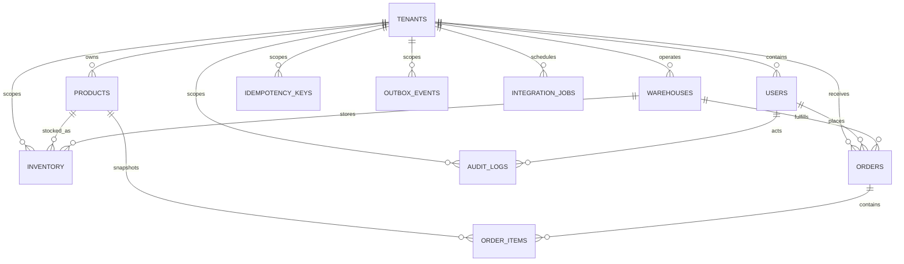

# Data model

The API uses MongoDB and Mongoose. Tenant-owned records carry a `tenantId`;
queries and unique constraints for tenant data should always include that ID.
ObjectId references are logical relationships: MongoDB does not enforce foreign
keys, so services must validate referenced records and maintain tenant
boundaries.

## Collections

| Collection         | Responsibility and relationships                                                                                                                                            |
| ------------------ | --------------------------------------------------------------------------------------------------------------------------------------------------------------------------- |
| `tenants`          | Organization root. Unique `slug`, status, plan, defaults, and settings. `createdBy` optionally references a user.                                                           |
| `users`            | Tenant-scoped identity, normalized email, password hash, role, and account status. Email is unique within a tenant. Password hashes are excluded from normal query results. |
| `products`         | Tenant catalog entries. SKU is unique within a tenant.                                                                                                                      |
| `warehouses`       | Tenant fulfillment locations. Warehouse code is unique within a tenant.                                                                                                     |
| `inventory`        | Quantity for one tenant/product/warehouse combination. That combination is unique; quantities are non-negative integers.                                                    |
| `orders`           | Tenant order with customer and warehouse references, product references, and immutable item name/SKU/price snapshots. Indexes support tenant, warehouse, customer, status, and date queries. |
| `idempotency_keys` | Tenant-scoped request key and request hash with a cached response. Unique by tenant and key; TTL index expires records at `expiresAt`.                                      |
| `outbox_events`    | Durable, tenant-scoped events associated with an aggregate. Status and availability indexes support publisher polling.                                                      |
| `audit_logs`       | Append-only tenant audit entries with optional user actor, action, resource, request context, and metadata.                                                                 |
| `integration_jobs` | Tenant-scoped provider operation, payload/result, retry schedule, lease, and status. Partial unique index deduplicates non-null provider idempotency keys per tenant.       |

Mongoose declares indexes in the schemas. Ensure index creation is enabled in the
deployment's migration/startup process before relying on uniqueness or TTL
behavior. TTL deletion is asynchronous; application logic must also treat
`expiresAt <= now` records as expired.
